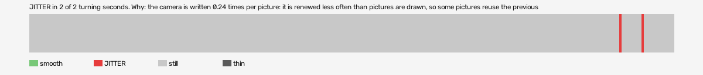

# alice-madness-returns-vr (openxr, VR, headset or simulator not recorded)

Log `alice-madness-returns-vr_20261026-115519.jl`, checked 2026-10-26 12:01. `[measured]`: one VR session.

JITTER in 2 of 2 turning seconds. Why: the camera is written 0.24 times per picture: it is renewed less often than pictures are drawn, so some pictures reuse the previous camera (the rate fault); 98% of pose reads returned the same pose as the read before while the head was turning: the runtime handed a stale pose (the pose is read at the wrong moment, or from a cached copy, not once per frame after waiting for the frame).

- quality: **good**
- 319.79 s; 60.0 pictures, 60.0 pose reads, 15.3 camera writes a second
- turning 2 s, jitter 2 s

## Why

- the camera is written 0.24 times per picture: it is renewed less often than pictures are drawn, so some pictures reuse the previous camera (the rate fault)
- 98% of pose reads returned the same pose as the read before while the head was turning: the runtime handed a stale pose (the pose is read at the wrong moment, or from a cached copy, not once per frame after waiting for the frame)

## Controllers (Occlusion Drift BeG0nE)

- left: 60.0 reads a second; untracked 0.0% of the time, longest 0.0 s; 0% of the untracked reads came while the other controller was within 0.3 m
- right: 60.0 reads a second; untracked 0.0% of the time, longest 0.0 s; 0% of the untracked reads came while the other controller was within 0.3 m

## On the recording

- **OpenXR Simulator preview**: `begone_second_2026-10-26_11-55-31.mp4`; the log starts -12.44 s into it (log clock).
  - jitter 293-294s: ffmpeg is not installed
  - jitter 304-305s: ffmpeg is not installed
- **game window**: `begone_2026-10-26_11-55-31.mp4`; the log starts -12.44 s into it (log clock).
  - jitter 293-294s: ffmpeg is not installed
  - jitter 304-305s: ffmpeg is not installed
