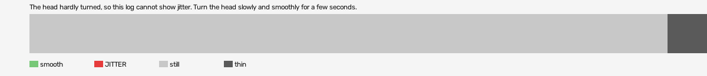

# hard-reset-vr (openxr, VR, headset or simulator not recorded)

Log `hard-reset-vr_20261016-135426.jl`, checked 2026-10-16 13:54. `[measured]`: one VR session.

The head hardly turned, so this log cannot show jitter. Turn the head slowly and smoothly for a few seconds.

- quality: **no-movement**
- 14.21 s; 59.9 pictures, 59.9 pose reads, 0.0 camera writes a second
- turning 0 s, jitter 0 s

