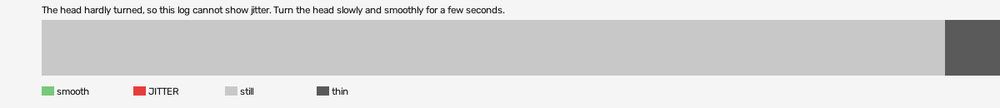

# hard-reset-vr (openxr, VR, headset or simulator not recorded)

Log `hard-reset-vr_20261016-135715.jl`, checked 2026-10-16 13:57. `[measured]`: one VR session.

The head hardly turned, so this log cannot show jitter. Turn the head slowly and smoothly for a few seconds.

- quality: **no-movement**
- 5.07 s; 60.9 pictures, 60.9 pose reads, 0.0 camera writes a second
- turning 0 s, jitter 0 s

