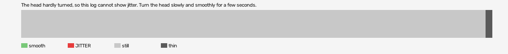

# hard-reset-vr (openxr, VR, headset or simulator not recorded)

Log `hard-reset-vr_20261017-132639.jl`, checked 2026-10-17 13:28. `[measured]`: one VR session.

The head hardly turned, so this log cannot show jitter. Turn the head slowly and smoothly for a few seconds.

- quality: **no-movement**
- 77.15 s; 59.9 pictures, 59.9 pose reads, 0.0 camera writes a second
- turning 0 s, jitter 0 s

## Controllers (Occlusion Drift BeG0nE)

- left: 59.9 reads a second; untracked 0.0% of the time, longest 0.0 s; 0% of the untracked reads came while the other controller was within 0.3 m
- right: 59.9 reads a second; untracked 0.0% of the time, longest 0.0 s; 0% of the untracked reads came while the other controller was within 0.3 m

