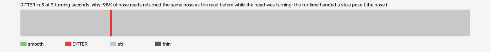

# hard-reset-vr (openxr, VR, headset or simulator not recorded)

Log `hard-reset-vr_20261017-140824.jl`, checked 2026-10-17 14:22. `[measured]`: one VR session.

JITTER in 3 of 3 turning seconds. Why: 98% of pose reads returned the same pose as the read before while the head was turning: the runtime handed a stale pose (the pose is read at the wrong moment, or from a cached copy, not once per frame after waiting for the frame); 100% of pictures carry a camera that matches the pose BEFORE last: the camera trails the pose by one frame (swim, not jitter).

- quality: **good**
- 793.36 s; 60.1 pictures, 60.1 pose reads, 167.7 camera writes a second
- turning 3 s, jitter 3 s

## Why

- 98% of pose reads returned the same pose as the read before while the head was turning: the runtime handed a stale pose (the pose is read at the wrong moment, or from a cached copy, not once per frame after waiting for the frame)
- 100% of pictures carry a camera that matches the pose BEFORE last: the camera trails the pose by one frame (swim, not jitter)

## Controllers (Occlusion Drift BeG0nE)

- left: 60.1 reads a second; untracked 0.0% of the time, longest 0.0 s; 0% of the untracked reads came while the other controller was within 0.3 m
- right: 60.1 reads a second; untracked 0.0% of the time, longest 0.0 s; 0% of the untracked reads came while the other controller was within 0.3 m

