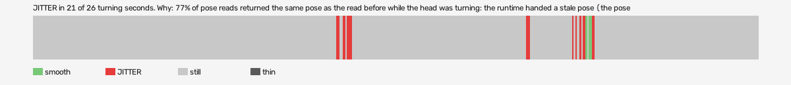

# hard-reset-vr (openxr, VR, headset or simulator not recorded)

Log `hard-reset-vr_20261017-142209.jl`, checked 2026-10-17 14:33. `[measured]`: one VR session.

JITTER in 21 of 26 turning seconds. Why: 77% of pose reads returned the same pose as the read before while the head was turning: the runtime handed a stale pose (the pose is read at the wrong moment, or from a cached copy, not once per frame after waiting for the frame).

- quality: **good**
- 616.93 s; 60.6 pictures, 60.6 pose reads, 216.9 camera writes a second
- turning 26 s, jitter 21 s

## Why

- 77% of pose reads returned the same pose as the read before while the head was turning: the runtime handed a stale pose (the pose is read at the wrong moment, or from a cached copy, not once per frame after waiting for the frame)

## Controllers (Occlusion Drift BeG0nE)

- left: 60.6 reads a second; untracked 0.0% of the time, longest 0.0 s; 0% of the untracked reads came while the other controller was within 0.3 m
- right: 60.6 reads a second; untracked 0.0% of the time, longest 0.0 s; 0% of the untracked reads came while the other controller was within 0.3 m

