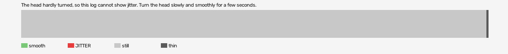

# hard-reset-vr (openxr, VR, headset or simulator not recorded)

Log `hard-reset-vr_20261017-161046.jl`, checked 2026-10-17 16:15. `[measured]`: one VR session.

The head hardly turned, so this log cannot show jitter. Turn the head slowly and smoothly for a few seconds.

- quality: **no-movement**
- 268.09 s; 60.1 pictures, 60.1 pose reads, 459.5 camera writes a second
- turning 0 s, jitter 0 s

## Controllers (Occlusion Drift BeG0nE)

- left: 60.1 reads a second; untracked 0.0% of the time, longest 0.0 s; 0% of the untracked reads came while the other controller was within 0.3 m
- right: 60.1 reads a second; untracked 0.0% of the time, longest 0.0 s; 0% of the untracked reads came while the other controller was within 0.3 m

