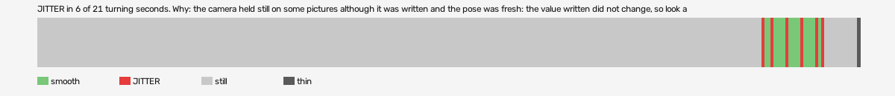

# hard-reset-vr (openxr, VR, headset or simulator not recorded)

Log `hard-reset-vr_20261017-171007.jl`, checked 2026-10-17 17:15. `[measured]`: one VR session.

JITTER in 6 of 21 turning seconds. Why: the camera held still on some pictures although it was written and the pose was fresh: the value written did not change, so look at what sits between the pose and the camera (a smoothing step, a rounding, a once-per-tick game update).

- quality: **good**
- 274.1 s; 59.8 pictures, 59.8 pose reads, 685.1 camera writes a second
- turning 21 s, jitter 6 s

## Why

- the camera held still on some pictures although it was written and the pose was fresh: the value written did not change, so look at what sits between the pose and the camera (a smoothing step, a rounding, a once-per-tick game update)

## Controllers (Occlusion Drift BeG0nE)

- left: 59.8 reads a second; untracked 0.0% of the time, longest 0.0 s; 0% of the untracked reads came while the other controller was within 0.3 m
- right: 59.8 reads a second; untracked 0.0% of the time, longest 0.0 s; 0% of the untracked reads came while the other controller was within 0.3 m

## On the recording

- **OpenXR Simulator preview**: `begone_second_2026-10-17_17-10-27.mp4`; the log starts -19.77 s into it (log file made).
  - jitter 242-243s: 90 frames; on screen 2 pictures held, 2 jumped, in `<recordings>/hard-reset-vr/begone-frames/2026-10-17_17-14-41_openxr/jitter_242-243s_headset/` (sheet.jpg)
  - jitter 245-246s: 90 frames; on screen 1 pictures held, 1 jumped, in `<recordings>/hard-reset-vr/begone-frames/2026-10-17_17-14-41_openxr/jitter_245-246s_headset/` (sheet.jpg)
  - jitter 250-251s: 90 frames; on screen 1 pictures held, 0 jumped, in `<recordings>/hard-reset-vr/begone-frames/2026-10-17_17-14-41_openxr/jitter_250-251s_headset/` (sheet.jpg)
  - smooth 243-244s: 90 frames; on screen 2 pictures held, 1 jumped, in `<recordings>/hard-reset-vr/begone-frames/2026-10-17_17-14-41_openxr/smooth_243-244s_headset/` (sheet.jpg)
- **game window**: `begone_2026-10-17_17-10-26.mp4`; the log starts -19.77 s into it (log file made).
  - jitter 242-243s: 90 frames; on screen 1 pictures held, 2 jumped, in `<recordings>/hard-reset-vr/begone-frames/2026-10-17_17-14-41_openxr/jitter_242-243s_game/` (sheet.jpg)
  - jitter 245-246s: 90 frames; on screen 0 pictures held, 1 jumped, in `<recordings>/hard-reset-vr/begone-frames/2026-10-17_17-14-41_openxr/jitter_245-246s_game/` (sheet.jpg)
  - jitter 250-251s: 90 frames; on screen 0 pictures held, 0 jumped, in `<recordings>/hard-reset-vr/begone-frames/2026-10-17_17-14-41_openxr/jitter_250-251s_game/` (sheet.jpg)
  - smooth 243-244s: 90 frames; on screen 3 pictures held, 2 jumped, in `<recordings>/hard-reset-vr/begone-frames/2026-10-17_17-14-41_openxr/smooth_243-244s_game/` (sheet.jpg)
