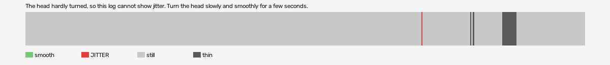

# hard-reset-vr (openxr, VR, headset or simulator not recorded)

Log `hard-reset-vr_20261017-174540.jl`, checked 2026-10-17 17:53. `[measured]`: one VR session.

The head hardly turned, so this log cannot show jitter. Turn the head slowly and smoothly for a few seconds.

- quality: **no-movement**
- 434.74 s; 60.8 pictures, 60.8 pose reads, 244.7 camera writes a second
- turning 1 s, jitter 1 s

## Controllers (Occlusion Drift BeG0nE)

- left: 60.8 reads a second; untracked 0.0% of the time, longest 0.0 s; 0% of the untracked reads came while the other controller was within 0.3 m
- right: 60.8 reads a second; untracked 0.0% of the time, longest 0.0 s; 0% of the untracked reads came while the other controller was within 0.3 m

## On the recording

- no recording covers this session.
