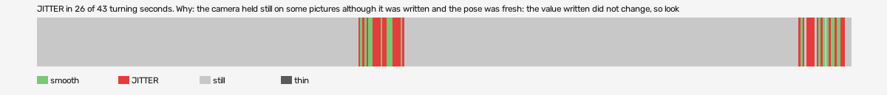

# hard-reset-vr (openxr, VR, headset or simulator not recorded)

Log `hard-reset-vr_20261017-175422.jl`, checked 2026-10-17 18:01. `[measured]`: one VR session.

JITTER in 26 of 43 turning seconds. Why: the camera held still on some pictures although it was written and the pose was fresh: the value written did not change, so look at what sits between the pose and the camera (a smoothing step, a rounding, a once-per-tick game update).

- quality: **good**
- 404.48 s; 63.3 pictures, 63.3 pose reads, 255.8 camera writes a second
- turning 43 s, jitter 26 s

## Why

- the camera held still on some pictures although it was written and the pose was fresh: the value written did not change, so look at what sits between the pose and the camera (a smoothing step, a rounding, a once-per-tick game update)

## Controllers (Occlusion Drift BeG0nE)

- left: 63.3 reads a second; untracked 0.0% of the time, longest 0.0 s; 0% of the untracked reads came while the other controller was within 0.3 m
- right: 63.3 reads a second; untracked 0.0% of the time, longest 0.0 s; 0% of the untracked reads came while the other controller was within 0.3 m

## On the recording

- **OpenXR Simulator preview**: `begone_second_2026-10-17_18-00-26.mp4`; the log starts -363.54 s into it (log clock).
  - jitter 379-380s: 90 frames; on screen 1 pictures held, 3 jumped, in `<recordings>/hard-reset-vr/begone-frames/2026-10-17_18-01-07_openxr/jitter_379-380s_headset/` (sheet.jpg)
  - jitter 381-382s: 90 frames; on screen 0 pictures held, 0 jumped, in `<recordings>/hard-reset-vr/begone-frames/2026-10-17_18-01-07_openxr/jitter_381-382s_headset/` (sheet.jpg)
  - jitter 383-387s: 150 frames; on screen 19 pictures held, 10 jumped, in `<recordings>/hard-reset-vr/begone-frames/2026-10-17_18-01-07_openxr/jitter_383-387s_headset/` (sheet.jpg)
  - smooth 380-381s: 90 frames; on screen 0 pictures held, 0 jumped, in `<recordings>/hard-reset-vr/begone-frames/2026-10-17_18-01-07_openxr/smooth_380-381s_headset/` (sheet.jpg)
- **game window**: `begone_2026-10-17_18-00-25.mp4`; the log starts -363.54 s into it (log clock).
  - jitter 379-380s: 90 frames; on screen 2 pictures held, 4 jumped, in `<recordings>/hard-reset-vr/begone-frames/2026-10-17_18-01-07_openxr/jitter_379-380s_game/` (sheet.jpg)
  - jitter 381-382s: 90 frames; on screen 4 pictures held, 0 jumped, in `<recordings>/hard-reset-vr/begone-frames/2026-10-17_18-01-07_openxr/jitter_381-382s_game/` (sheet.jpg)
  - jitter 383-387s: 150 frames; on screen 12 pictures held, 6 jumped, in `<recordings>/hard-reset-vr/begone-frames/2026-10-17_18-01-07_openxr/jitter_383-387s_game/` (sheet.jpg)
  - smooth 380-381s: 90 frames; on screen 7 pictures held, 5 jumped, in `<recordings>/hard-reset-vr/begone-frames/2026-10-17_18-01-07_openxr/smooth_380-381s_game/` (sheet.jpg)
