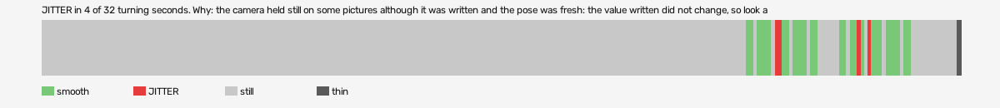

# hard-reset-vr (openxr, VR, headset or simulator not recorded)

Log `hard-reset-vr_20261017-180427.jl`, checked 2026-10-17 18:09. `[measured]`: one VR session.

JITTER in 4 of 32 turning seconds. Why: the camera held still on some pictures although it was written and the pose was fresh: the value written did not change, so look at what sits between the pose and the camera (a smoothing step, a rounding, a once-per-tick game update).

- quality: **good**
- 256.25 s; 62.7 pictures, 62.7 pose reads, 289.3 camera writes a second
- turning 32 s, jitter 4 s

## Why

- the camera held still on some pictures although it was written and the pose was fresh: the value written did not change, so look at what sits between the pose and the camera (a smoothing step, a rounding, a once-per-tick game update)

## Controllers (Occlusion Drift BeG0nE)

- left: 62.7 reads a second; untracked 0.0% of the time, longest 0.0 s; 0% of the untracked reads came while the other controller was within 0.3 m
- right: 62.7 reads a second; untracked 0.0% of the time, longest 0.0 s; 0% of the untracked reads came while the other controller was within 0.3 m

## On the recording

- **game window**: `begone_2026-10-17_18-04-32.mp4`; the log starts -5.64 s into it (log clock).
  - jitter 205-207s: 150 frames; on screen 3 pictures held, 1 jumped, in `<recordings>/hard-reset-vr/begone-frames/2026-10-17_18-08-44_openxr/jitter_205-207s_game/` (sheet.jpg)
  - jitter 228-229s: 90 frames; on screen 7 pictures held, 0 jumped, in `<recordings>/hard-reset-vr/begone-frames/2026-10-17_18-08-44_openxr/jitter_228-229s_game/` (sheet.jpg)
  - jitter 231-232s: 90 frames; on screen 0 pictures held, 0 jumped, in `<recordings>/hard-reset-vr/begone-frames/2026-10-17_18-08-44_openxr/jitter_231-232s_game/` (sheet.jpg)
  - smooth 197-198s: 90 frames; on screen 5 pictures held, 0 jumped, in `<recordings>/hard-reset-vr/begone-frames/2026-10-17_18-08-44_openxr/smooth_197-198s_game/` (sheet.jpg)
