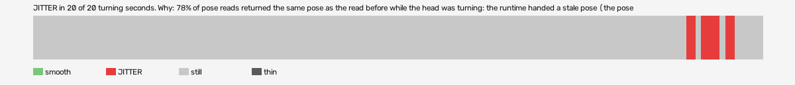

# hard-reset-vr (openxr, VR, headset or simulator not recorded)

Log `hard-reset-vr_20261017-184507.jl`, checked 2026-10-17 18:52. `[measured]`: one VR session.

JITTER in 20 of 20 turning seconds. Why: 78% of pose reads returned the same pose as the read before while the head was turning: the runtime handed a stale pose (the pose is read at the wrong moment, or from a cached copy, not once per frame after waiting for the frame); 95% of pictures carry a camera that matches the pose BEFORE last: the camera trails the pose by one frame (swim, not jitter).

- quality: **good**
- 392.58 s; 61.8 pictures, 61.8 pose reads, 368.2 camera writes a second
- turning 20 s, jitter 20 s

## Why

- 78% of pose reads returned the same pose as the read before while the head was turning: the runtime handed a stale pose (the pose is read at the wrong moment, or from a cached copy, not once per frame after waiting for the frame)
- 95% of pictures carry a camera that matches the pose BEFORE last: the camera trails the pose by one frame (swim, not jitter)

## Controllers (Occlusion Drift BeG0nE)

- left: 61.8 reads a second; untracked 0.0% of the time, longest 0.0 s; 0% of the untracked reads came while the other controller was within 0.3 m
- right: 61.8 reads a second; untracked 0.0% of the time, longest 0.0 s; 0% of the untracked reads came while the other controller was within 0.3 m

## On the recording

- **OpenXR Simulator preview**: `begone_second_2026-10-17_18-47-21.mp4`; the log starts -134.64 s into it (log clock).
  - jitter 352-357s: 150 frames; on screen 10 pictures held, 36 jumped, in `<recordings>/hard-reset-vr/begone-frames/2026-10-17_18-51-39_openxr/jitter_352-357s_headset/` (sheet.jpg)
  - jitter 360-370s: 150 frames; on screen 4 pictures held, 9 jumped, in `<recordings>/hard-reset-vr/begone-frames/2026-10-17_18-51-39_openxr/jitter_360-370s_headset/` (sheet.jpg)
  - jitter 373-378s: 150 frames; on screen 18 pictures held, 15 jumped, in `<recordings>/hard-reset-vr/begone-frames/2026-10-17_18-51-39_openxr/jitter_373-378s_headset/` (sheet.jpg)
- **game window**: `begone_2026-10-17_18-47-21.mp4`; the log starts -134.64 s into it (log clock).
  - jitter 352-357s: 150 frames; on screen 2 pictures held, 31 jumped, in `<recordings>/hard-reset-vr/begone-frames/2026-10-17_18-51-39_openxr/jitter_352-357s_game/` (sheet.jpg)
  - jitter 360-370s: 150 frames; on screen 0 pictures held, 14 jumped, in `<recordings>/hard-reset-vr/begone-frames/2026-10-17_18-51-39_openxr/jitter_360-370s_game/` (sheet.jpg)
  - jitter 373-378s: 150 frames; on screen 4 pictures held, 39 jumped, in `<recordings>/hard-reset-vr/begone-frames/2026-10-17_18-51-39_openxr/jitter_373-378s_game/` (sheet.jpg)
- ⚠️ the recording broke at 135 s of the log: OBS showed "OBS has crashed!" (restarted).
