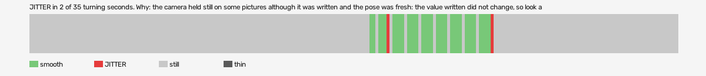

# hard-reset-vr (openxr, VR, headset or simulator not recorded)

Log `hard-reset-vr_20261017-191617.jl`, checked 2026-10-17 19:20. `[measured]`: one VR session.

JITTER in 2 of 35 turning seconds. Why: the camera held still on some pictures although it was written and the pose was fresh: the value written did not change, so look at what sits between the pose and the camera (a smoothing step, a rounding, a once-per-tick game update); the pose was 15 ms old when the camera was written: more than a frame.

- quality: **good**
- 224.44 s; 60.4 pictures, 60.4 pose reads, 430.0 camera writes a second
- turning 35 s, jitter 2 s

## Why

- the camera held still on some pictures although it was written and the pose was fresh: the value written did not change, so look at what sits between the pose and the camera (a smoothing step, a rounding, a once-per-tick game update)
- the pose was 15 ms old when the camera was written: more than a frame

## Controllers (Occlusion Drift BeG0nE)

- left: 60.4 reads a second; untracked 0.0% of the time, longest 0.0 s; 0% of the untracked reads came while the other controller was within 0.3 m
- right: 60.4 reads a second; untracked 0.0% of the time, longest 0.0 s; 0% of the untracked reads came while the other controller was within 0.3 m

## On the recording

- **OpenXR Simulator preview**: `begone_second_2026-10-17_19-16-25.mp4`; the log starts -8.18 s into it (log clock).
  - jitter 124-125s: 90 frames; on screen 11 pictures held, 3 jumped, in `<recordings>/hard-reset-vr/begone-frames/2026-10-17_19-20-01_openxr/jitter_124-125s_headset/` (sheet.jpg)
  - jitter 160-161s: 90 frames; on screen 2 pictures held, 0 jumped, in `<recordings>/hard-reset-vr/begone-frames/2026-10-17_19-20-01_openxr/jitter_160-161s_headset/` (sheet.jpg)
  - smooth 118-119s: 90 frames; on screen 3 pictures held, 1 jumped, in `<recordings>/hard-reset-vr/begone-frames/2026-10-17_19-20-01_openxr/smooth_118-119s_headset/` (sheet.jpg)
- **game window**: `begone_2026-10-17_19-16-25.mp4`; the log starts -8.18 s into it (log clock).
  - jitter 124-125s: 90 frames; on screen 2 pictures held, 1 jumped, in `<recordings>/hard-reset-vr/begone-frames/2026-10-17_19-20-01_openxr/jitter_124-125s_game/` (sheet.jpg)
  - jitter 160-161s: 90 frames; on screen 9 pictures held, 2 jumped, in `<recordings>/hard-reset-vr/begone-frames/2026-10-17_19-20-01_openxr/jitter_160-161s_game/` (sheet.jpg)
  - smooth 118-119s: 90 frames; on screen 2 pictures held, 1 jumped, in `<recordings>/hard-reset-vr/begone-frames/2026-10-17_19-20-01_openxr/smooth_118-119s_game/` (sheet.jpg)
