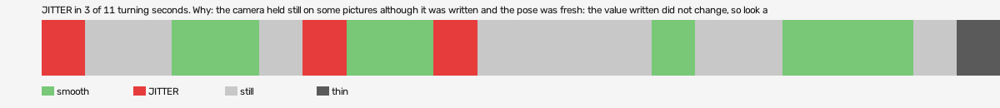

# hard-reset-vr (openxr, VR, headset or simulator not recorded)

Log `hard-reset-vr_20261030-012343.jl`, checked 2026-10-30 10:43. `[measured]`: one VR session.

JITTER in 3 of 11 turning seconds. Why: the camera held still on some pictures although it was written and the pose was fresh: the value written did not change, so look at what sits between the pose and the camera (a smoothing step, a rounding, a once-per-tick game update).

- quality: **good**
- 21.03 s; 71.2 pictures, 71.2 pose reads, 12203.4 camera writes a second
- turning 11 s, jitter 3 s

## Why

- the camera held still on some pictures although it was written and the pose was fresh: the value written did not change, so look at what sits between the pose and the camera (a smoothing step, a rounding, a once-per-tick game update)

## On the recording

- no recording covers this session.
