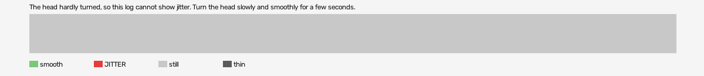

# hard-reset-vr (openxr, VR, headset or simulator not recorded)

Log `hard-reset-vr_20261124-015742.jl`, checked 2026-11-24 02:00. `[measured]`: one VR session.

The head hardly turned, so this log cannot show jitter. Turn the head slowly and smoothly for a few seconds.

- quality: **no-movement**
- 138.63 s; 90.0 pictures, 90.0 pose reads, 2451.4 camera writes a second
- turning 0 s, jitter 0 s

## Controllers (Occlusion Drift BeG0nE)

- left: 90.0 reads a second; untracked 0.0% of the time, longest 0.0 s; 0% of the untracked reads came while the other controller was within 0.3 m
- right: 90.0 reads a second; untracked 0.0% of the time, longest 0.0 s; 0% of the untracked reads came while the other controller was within 0.3 m

## On the recording

- **OpenXR Simulator preview**: `begone_second_2026-11-24_01-58-41.mp4`; the log starts -59.02 s into it (log clock).
- **game window**: `begone_2026-11-24_01-58-41.mp4`; the log starts -59.02 s into it (log clock).
