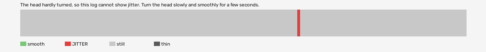

# hard-reset-vr (openxr, VR, headset or simulator not recorded)

Log `hard-reset-vr_20261127-141313.jl`, checked 2026-11-27 14:16. `[measured]`: one VR session.

The head hardly turned, so this log cannot show jitter. Turn the head slowly and smoothly for a few seconds.

- quality: **no-movement**
- 147.84 s; 90.0 pictures, 90.0 pose reads, 2085.1 camera writes a second
- turning 1 s, jitter 1 s

## Controllers (Occlusion Drift BeG0nE)

- left: 90.0 reads a second; untracked 0.0% of the time, longest 0.0 s; 0% of the untracked reads came while the other controller was within 0.3 m
- right: 90.0 reads a second; untracked 0.0% of the time, longest 0.0 s; 0% of the untracked reads came while the other controller was within 0.3 m

## On the recording

- **OpenXR Simulator preview**: `begone_second_2026-11-27_14-13-22.mp4`; the log starts -9.80 s into it (log clock).
  - jitter 92-93s: 90 frames; on screen 0 pictures held, 0 jumped, in `<recordings>/hard-reset-vr/begone-frames/2026-11-27_14-15-41_openxr/jitter_92-93s_headset/` (sheet.jpg)
- **game window**: `begone_2026-11-27_14-13-22.mp4`; the log starts -9.80 s into it (log clock).
  - jitter 92-93s: 90 frames; on screen 0 pictures held, 0 jumped, in `<recordings>/hard-reset-vr/begone-frames/2026-11-27_14-15-41_openxr/jitter_92-93s_game/` (sheet.jpg)
