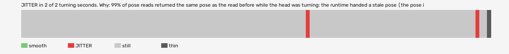

# hard-reset-vr (openxr, VR, headset or simulator not recorded)

Log `hard-reset-vr_20261127-141604.jl`, checked 2026-11-27 14:18. `[measured]`: one VR session.

JITTER in 2 of 2 turning seconds. Why: 99% of pose reads returned the same pose as the read before while the head was turning: the runtime handed a stale pose (the pose is read at the wrong moment, or from a cached copy, not once per frame after waiting for the frame).

- quality: **good**
- 121.19 s; 90.0 pictures, 90.0 pose reads, 2627.9 camera writes a second
- turning 2 s, jitter 2 s

## Why

- 99% of pose reads returned the same pose as the read before while the head was turning: the runtime handed a stale pose (the pose is read at the wrong moment, or from a cached copy, not once per frame after waiting for the frame)

## Controllers (Occlusion Drift BeG0nE)

- left: 90.0 reads a second; untracked 0.0% of the time, longest 0.0 s; 0% of the untracked reads came while the other controller was within 0.3 m
- right: 90.0 reads a second; untracked 0.0% of the time, longest 0.0 s; 0% of the untracked reads came while the other controller was within 0.3 m

## On the recording

- **OpenXR Simulator preview**: `begone_second_2026-11-27_14-16-26.mp4`; the log starts -22.88 s into it (log clock).
  - jitter 74-75s: 90 frames; on screen 2 pictures held, 2 jumped, in `<recordings>/hard-reset-vr/begone-frames/2026-11-27_14-18-05_openxr/jitter_74-75s_headset/` (sheet.jpg)
  - jitter 118-119s: 90 frames; on screen 11 pictures held, 1 jumped, in `<recordings>/hard-reset-vr/begone-frames/2026-11-27_14-18-05_openxr/jitter_118-119s_headset/` (sheet.jpg)
- **game window**: `begone_2026-11-27_14-16-26.mp4`; the log starts -22.88 s into it (log clock).
  - jitter 74-75s: 90 frames; on screen 6 pictures held, 1 jumped, in `<recordings>/hard-reset-vr/begone-frames/2026-11-27_14-18-05_openxr/jitter_74-75s_game/` (sheet.jpg)
  - jitter 118-119s: 90 frames; on screen 8 pictures held, 1 jumped, in `<recordings>/hard-reset-vr/begone-frames/2026-11-27_14-18-05_openxr/jitter_118-119s_game/` (sheet.jpg)
