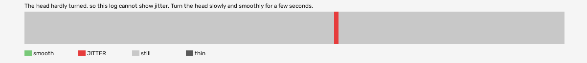

# hard-reset-vr (openxr, VR, headset or simulator not recorded)

Log `hard-reset-vr_20261127-142453.jl`, checked 2026-11-27 14:27. `[measured]`: one VR session.

The head hardly turned, so this log cannot show jitter. Turn the head slowly and smoothly for a few seconds.

- quality: **no-movement**
- 114.63 s; 89.9 pictures, 89.9 pose reads, 2763.0 camera writes a second
- turning 1 s, jitter 1 s

## Controllers (Occlusion Drift BeG0nE)

- left: 89.9 reads a second; untracked 0.0% of the time, longest 0.0 s; 0% of the untracked reads came while the other controller was within 0.3 m
- right: 89.9 reads a second; untracked 0.0% of the time, longest 0.0 s; 0% of the untracked reads came while the other controller was within 0.3 m

## On the recording

- **OpenXR Simulator preview**: `begone_second_2026-11-27_14-25-01.mp4`; the log starts -7.91 s into it (log clock).
  - jitter 66-67s: 90 frames; on screen 0 pictures held, 0 jumped, in `<recordings>/hard-reset-vr/begone-frames/2026-11-27_14-26-48_openxr/jitter_66-67s_headset/` (sheet.jpg)
- **game window**: `begone_2026-11-27_14-25-01.mp4`; the log starts -7.91 s into it (log clock).
  - jitter 66-67s: 90 frames; on screen 0 pictures held, 0 jumped, in `<recordings>/hard-reset-vr/begone-frames/2026-11-27_14-26-48_openxr/jitter_66-67s_game/` (sheet.jpg)
