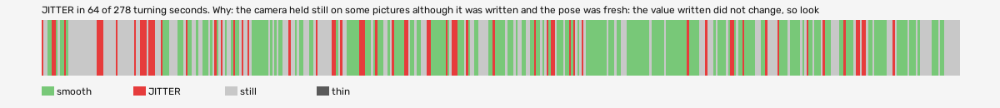

# hard-reset-vr (openxr, VR, headset or simulator not recorded)

Log `hard-reset-vr_20261128-013435.jl`, checked 2026-11-28 01:42. `[measured]`: one VR session.

JITTER in 64 of 278 turning seconds. Why: the camera held still on some pictures although it was written and the pose was fresh: the value written did not change, so look at what sits between the pose and the camera (a smoothing step, a rounding, a once-per-tick game update); 85% of pictures carry a camera that matches the pose BEFORE last: the camera trails the pose by one frame (swim, not jitter).

- quality: **good**
- 444.53 s; 71.9 pictures, 71.9 pose reads, 717.7 camera writes a second
- turning 278 s, jitter 64 s

## Why

- the camera held still on some pictures although it was written and the pose was fresh: the value written did not change, so look at what sits between the pose and the camera (a smoothing step, a rounding, a once-per-tick game update)
- 85% of pictures carry a camera that matches the pose BEFORE last: the camera trails the pose by one frame (swim, not jitter)

## Controllers (Occlusion Drift BeG0nE)

- left: 71.9 reads a second; untracked 0.7% of the time, longest 3.17 s; 100% of the untracked reads came while the other controller was within 0.3 m
- right: 71.9 reads a second; untracked 0.8% of the time, longest 3.61 s; 88% of the untracked reads came while the other controller was within 0.3 m

## On the recording

- **game window**: `begone_2026-11-28_01-34-48.mp4`; the log starts -12.43 s into it (log clock).
  - jitter 27-30s: 150 frames; on screen 15 pictures held, 10 jumped, in `<recordings>/hard-reset-vr/begone-frames/2026-11-28_01-42-00_openxr/jitter_27-30s_game/` (sheet.jpg)
  - jitter 36-37s: 90 frames; on screen 7 pictures held, 7 jumped, in `<recordings>/hard-reset-vr/begone-frames/2026-11-28_01-42-00_openxr/jitter_36-37s_game/` (sheet.jpg)
  - jitter 45-46s: 90 frames; on screen 23 pictures held, 5 jumped, in `<recordings>/hard-reset-vr/begone-frames/2026-11-28_01-42-00_openxr/jitter_45-46s_game/` (sheet.jpg)
  - smooth 59-60s: 90 frames; on screen 13 pictures held, 9 jumped, in `<recordings>/hard-reset-vr/begone-frames/2026-11-28_01-42-00_openxr/smooth_59-60s_game/` (sheet.jpg)
