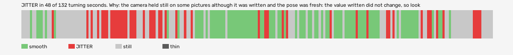

# hard-reset-vr (openxr, VR, headset or simulator not recorded)

Log `hard-reset-vr_20261128-214708.jl`, checked 2026-11-28 21:51. `[measured]`: one VR session.

JITTER in 48 of 132 turning seconds. Why: the camera held still on some pictures although it was written and the pose was fresh: the value written did not change, so look at what sits between the pose and the camera (a smoothing step, a rounding, a once-per-tick game update); 89% of pictures carry a camera that matches the pose BEFORE last: the camera trails the pose by one frame (swim, not jitter).

- quality: **good**
- 216.54 s; 71.3 pictures, 71.3 pose reads, 1510.3 camera writes a second
- turning 132 s, jitter 48 s

## Why

- the camera held still on some pictures although it was written and the pose was fresh: the value written did not change, so look at what sits between the pose and the camera (a smoothing step, a rounding, a once-per-tick game update)
- 89% of pictures carry a camera that matches the pose BEFORE last: the camera trails the pose by one frame (swim, not jitter)

## Controllers (Occlusion Drift BeG0nE)

- left: 71.3 reads a second; untracked 4.3% of the time, longest 7.81 s; 99% of the untracked reads came while the other controller was within 0.3 m
- right: 71.3 reads a second; untracked 5.3% of the time, longest 10.02 s; 81% of the untracked reads came while the other controller was within 0.3 m

## On the recording

- **game window**: `begone_2026-11-28_21-47-15.mp4`; the log starts -7.40 s into it (log clock).
  - jitter 14-15s: 90 frames; on screen 1 pictures held, 0 jumped, in `<recordings>/hard-reset-vr/begone-frames/2026-11-28_21-50-45_openxr/jitter_14-15s_game/` (sheet.jpg)
  - jitter 30-31s: 90 frames; on screen 3 pictures held, 12 jumped, in `<recordings>/hard-reset-vr/begone-frames/2026-11-28_21-50-45_openxr/jitter_30-31s_game/` (sheet.jpg)
  - jitter 32-33s: 90 frames; on screen 9 pictures held, 13 jumped, in `<recordings>/hard-reset-vr/begone-frames/2026-11-28_21-50-45_openxr/jitter_32-33s_game/` (sheet.jpg)
  - smooth 8-9s: 90 frames; on screen 43 pictures held, 32 jumped, in `<recordings>/hard-reset-vr/begone-frames/2026-11-28_21-50-45_openxr/smooth_8-9s_game/` (sheet.jpg)
