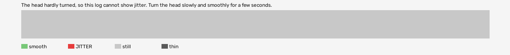

# hard-reset-vr (openxr, VR, headset or simulator not recorded)

Log `hard-reset-vr_20261128-222030.jl`, checked 2026-11-28 22:23. `[measured]`: one VR session.

The head hardly turned, so this log cannot show jitter. Turn the head slowly and smoothly for a few seconds.

- quality: **no-movement**
- 157.78 s; 89.9 pictures, 89.9 pose reads, 1732.5 camera writes a second
- turning 0 s, jitter 0 s

## Controllers (Occlusion Drift BeG0nE)

- left: 89.9 reads a second; untracked 0.0% of the time, longest 0.0 s; 0% of the untracked reads came while the other controller was within 0.3 m
- right: 89.9 reads a second; untracked 0.0% of the time, longest 0.0 s; 0% of the untracked reads came while the other controller was within 0.3 m

## On the recording

- **OpenXR Simulator preview**: `begone_second_2026-11-28_22-20-43.mp4`; the log starts -12.42 s into it (log clock).
- **game window**: `begone_2026-11-28_22-20-42.mp4`; the log starts -12.42 s into it (log clock).
