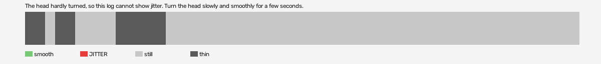

# mad-max-vr (openxr)

Log `mad-max-vr_20261015-170832.jl`, checked 2026-10-15 17:09. `[measured]`: one VR session.

The head hardly turned, so this log cannot show jitter. Turn the head slowly and smoothly for a few seconds.

- quality: **no-movement**
- 54.67 s; 47.2 pictures, 0.0 pose reads, 0.0 camera writes a second
- turning 0 s, jitter 0 s

