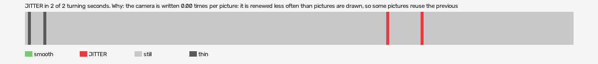

# mad-max-vr (openxr)

Log `mad-max-vr_20261015-171002.jl`, checked 2026-10-15 17:13. `[measured]`: one VR session.

JITTER in 2 of 2 turning seconds. Why: the camera is written 0.00 times per picture: it is renewed less often than pictures are drawn, so some pictures reuse the previous camera (the rate fault); 98% of pose reads returned the same pose as the read before while the head was turning: the runtime handed a stale pose (the pose is read at the wrong moment, or from a cached copy, not once per frame after waiting for the frame).

- quality: **good**
- 175.93 s; 56.3 pictures, 60.0 pose reads, 0.0 camera writes a second
- turning 2 s, jitter 2 s

## Why

- the camera is written 0.00 times per picture: it is renewed less often than pictures are drawn, so some pictures reuse the previous camera (the rate fault)
- 98% of pose reads returned the same pose as the read before while the head was turning: the runtime handed a stale pose (the pose is read at the wrong moment, or from a cached copy, not once per frame after waiting for the frame)

