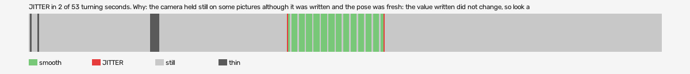

# mad-max-vr (openxr-openxr-simulator-runtime)

Log `mad-max-vr_20261015-183422.jl`, checked 2026-10-15 18:41. `[measured]`: one VR session.

JITTER in 2 of 53 turning seconds. Why: the camera held still on some pictures although it was written and the pose was fresh: the value written did not change, so look at what sits between the pose and the camera (a smoothing step, a rounding, a once-per-tick game update).

- quality: **good**
- 425.91 s; 57.6 pictures, 60.0 pose reads, 36.3 camera writes a second
- turning 53 s, jitter 2 s

## Why

- the camera held still on some pictures although it was written and the pose was fresh: the value written did not change, so look at what sits between the pose and the camera (a smoothing step, a rounding, a once-per-tick game update)

