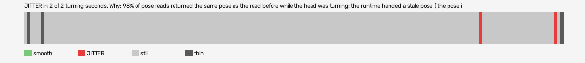

# mad-max-vr (openxr-openxr-simulator-runtime)

Log `mad-max-vr_20261015-185231.jl`, checked 2026-10-15 18:55. `[measured]`: one VR session.

JITTER in 2 of 2 turning seconds. Why: 98% of pose reads returned the same pose as the read before while the head was turning: the runtime handed a stale pose (the pose is read at the wrong moment, or from a cached copy, not once per frame after waiting for the frame).

- quality: **good**
- 185.06 s; 54.2 pictures, 59.5 pose reads, 11.0 camera writes a second
- turning 2 s, jitter 2 s

## Why

- 98% of pose reads returned the same pose as the read before while the head was turning: the runtime handed a stale pose (the pose is read at the wrong moment, or from a cached copy, not once per frame after waiting for the frame)

