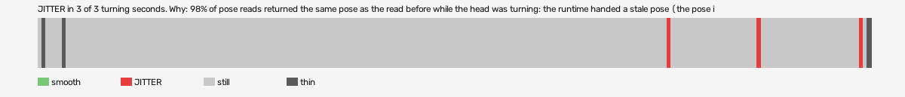

# mad-max-vr (openxr-openxr-simulator-runtime)

Log `mad-max-vr_20261015-190542.jl`, checked 2026-10-15 19:09. `[measured]`: one VR session.

JITTER in 3 of 3 turning seconds. Why: 98% of pose reads returned the same pose as the read before while the head was turning: the runtime handed a stale pose (the pose is read at the wrong moment, or from a cached copy, not once per frame after waiting for the frame).

- quality: **good**
- 203.01 s; 57.6 pictures, 60.0 pose reads, 15.4 camera writes a second
- turning 3 s, jitter 3 s

## Why

- 98% of pose reads returned the same pose as the read before while the head was turning: the runtime handed a stale pose (the pose is read at the wrong moment, or from a cached copy, not once per frame after waiting for the frame)

