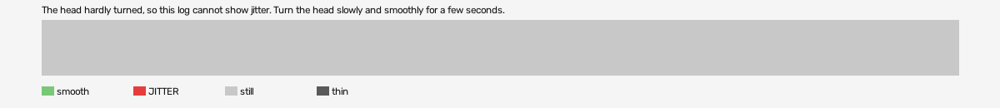

# mad-max-vr (openxr-openxr-simulator-runtime, headset simulator)

Log `mad-max-vr_20261124-020919.jl`, checked 2026-11-24 02:12. `[measured]`: one VR session.

The head hardly turned, so this log cannot show jitter. Turn the head slowly and smoothly for a few seconds.

- quality: **no-movement**
- 148.99 s; 172.2 pictures, 89.8 pose reads, 0.0 camera writes a second
- turning 0 s, jitter 0 s

## On the recording

- **OpenXR Simulator preview**: `begone_second_2026-11-24_02-09-28.mp4`; the log starts -9.09 s into it (log file made).
- **game window**: `begone_2026-11-24_02-09-28.mp4`; the log starts -9.09 s into it (log file made).
