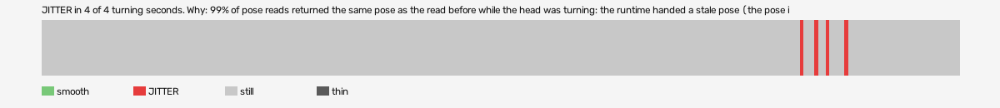

# mad-max-vr (openxr-openxr-simulator-runtime, headset simulator)

Log `mad-max-vr_20261124-021207.jl`, checked 2026-11-24 02:16. `[measured]`: one VR session.

JITTER in 4 of 4 turning seconds. Why: 99% of pose reads returned the same pose as the read before while the head was turning: the runtime handed a stale pose (the pose is read at the wrong moment, or from a cached copy, not once per frame after waiting for the frame); the pose is read 0.52 times per picture: less often than pictures are drawn.

- quality: **good**
- 246.56 s; 173.1 pictures, 90.0 pose reads, 38.7 camera writes a second
- turning 4 s, jitter 4 s

## Why

- 99% of pose reads returned the same pose as the read before while the head was turning: the runtime handed a stale pose (the pose is read at the wrong moment, or from a cached copy, not once per frame after waiting for the frame)
- the pose is read 0.52 times per picture: less often than pictures are drawn

## On the recording

- **OpenXR Simulator preview**: `begone_second_2026-11-24_02-12-30.mp4`; the log starts -22.67 s into it (log file made).
  - jitter 204-205s: 90 frames; on screen 0 pictures held, 0 jumped, in `<recordings>/mad-max-vr/begone-frames/2026-11-24_02-16-14_openxr-openxr-simulator-runtime/jitter_204-205s_headset/` (sheet.jpg)
  - jitter 208-209s: 90 frames; on screen 7 pictures held, 3 jumped, in `<recordings>/mad-max-vr/begone-frames/2026-11-24_02-16-14_openxr-openxr-simulator-runtime/jitter_208-209s_headset/` (sheet.jpg)
  - jitter 211-212s: 90 frames; on screen 7 pictures held, 3 jumped, in `<recordings>/mad-max-vr/begone-frames/2026-11-24_02-16-14_openxr-openxr-simulator-runtime/jitter_211-212s_headset/` (sheet.jpg)
- **game window**: `begone_2026-11-24_02-12-30.mp4`; the log starts -22.67 s into it (log file made).
  - jitter 204-205s: 90 frames; on screen 18 pictures held, 6 jumped, in `<recordings>/mad-max-vr/begone-frames/2026-11-24_02-16-14_openxr-openxr-simulator-runtime/jitter_204-205s_game/` (sheet.jpg)
  - jitter 208-209s: 90 frames; on screen 6 pictures held, 1 jumped, in `<recordings>/mad-max-vr/begone-frames/2026-11-24_02-16-14_openxr-openxr-simulator-runtime/jitter_208-209s_game/` (sheet.jpg)
  - jitter 211-212s: 90 frames; on screen 6 pictures held, 1 jumped, in `<recordings>/mad-max-vr/begone-frames/2026-11-24_02-16-14_openxr-openxr-simulator-runtime/jitter_211-212s_game/` (sheet.jpg)
