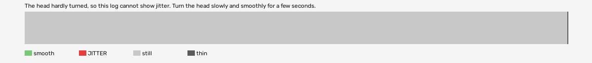

# mad-max-vr (openxr-openxr-simulator-runtime, headset simulator)

Log `mad-max-vr_20261127-110119.jl`, checked 2026-11-27 11:11. `[measured]`: one VR session.

The head hardly turned, so this log cannot show jitter. Turn the head slowly and smoothly for a few seconds.

- quality: **no-movement**
- 604.0 s; 174.2 pictures, 90.0 pose reads, 0.0 camera writes a second
- turning 0 s, jitter 0 s

## On the recording

- **OpenXR Simulator preview**: `begone_second_2026-11-27_11-01-30.mp4`; the log starts -10.85 s into it (log file made).
- **game window**: `begone_2026-11-27_11-01-30.mp4`; the log starts -10.85 s into it (log file made).
