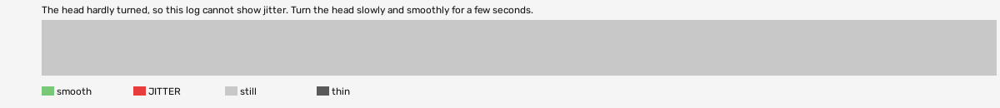

# mad-max-vr (openxr-openxr-simulator-runtime, headset simulator)

Log `mad-max-vr_20261127-112442.jl`, checked 2026-11-27 11:25. `[measured]`: one VR session.

The head hardly turned, so this log cannot show jitter. Turn the head slowly and smoothly for a few seconds.

- quality: **no-movement**
- 6.72 s; 128.9 pictures, 89.8 pose reads, 0.0 camera writes a second
- turning 0 s, jitter 0 s

## Controllers (Occlusion Drift BeG0nE)

- left: 89.7 reads a second; untracked 0.2% of the time, longest 0.0 s; 100% of the untracked reads came while the other controller was within 0.3 m
- right: 89.7 reads a second; untracked 0.2% of the time, longest 0.0 s; 100% of the untracked reads came while the other controller was within 0.3 m

## On the recording

- no recording covers this session.
