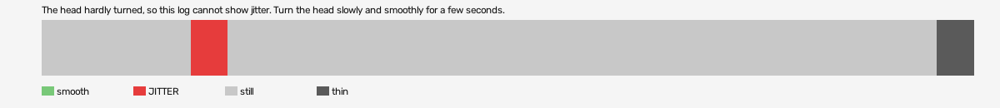

# manhunt-2003-vr (openxr)

Log `manhunt-2003-vr_20261012-174553.jl`, checked 2026-10-12 17:46. `[measured]`: one VR session.

The head hardly turned, so this log cannot show jitter. Turn the head slowly and smoothly for a few seconds.

- quality: **no-movement**
- 24.58 s; 50.7 pictures, 50.7 pose reads, 0.0 camera writes a second
- turning 1 s, jitter 1 s

