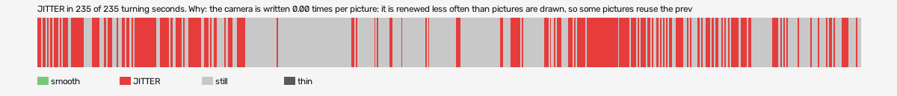

# manhunt-2003-vr (openxr, VR, headset or simulator not recorded)

Log `manhunt-2003-vr_20261030-132314.jl`, checked 2026-10-30 13:33. `[measured]`: one VR session.

JITTER in 235 of 235 turning seconds. Why: the camera is written 0.00 times per picture: it is renewed less often than pictures are drawn, so some pictures reuse the previous camera (the rate fault).

- quality: **good**
- 580.41 s; 71.9 pictures, 71.9 pose reads, 0.0 camera writes a second
- turning 235 s, jitter 235 s

## Why

- the camera is written 0.00 times per picture: it is renewed less often than pictures are drawn, so some pictures reuse the previous camera (the rate fault)

## On the recording

- **game window**: `begone_2026-10-30_13-23-20.mp4`; the log starts -7.16 s into it (log file made).
  - jitter 9-11s: 150 frames; on screen 28 pictures held, 8 jumped, in `<recordings>/manhunt-2003-vr/begone-frames/2026-10-30_13-32-54_openxr/jitter_9-11s_game/` (sheet.jpg)
  - jitter 12-15s: 150 frames; on screen 31 pictures held, 15 jumped, in `<recordings>/manhunt-2003-vr/begone-frames/2026-10-30_13-32-54_openxr/jitter_12-15s_game/` (sheet.jpg)
  - jitter 16-17s: 90 frames; on screen 8 pictures held, 3 jumped, in `<recordings>/manhunt-2003-vr/begone-frames/2026-10-30_13-32-54_openxr/jitter_16-17s_game/` (sheet.jpg)
