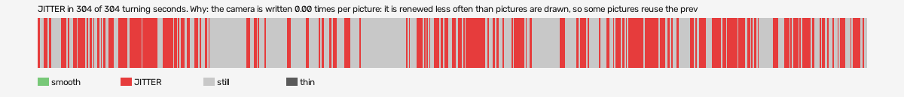

# manhunt-2003-vr (openxr, VR, headset or simulator not recorded)

Log `manhunt-2003-vr_20261030-133417.jl`, checked 2026-10-30 13:45. `[measured]`: one VR session.

JITTER in 304 of 304 turning seconds. Why: the camera is written 0.00 times per picture: it is renewed less often than pictures are drawn, so some pictures reuse the previous camera (the rate fault).

- quality: **good**
- 653.46 s; 72.0 pictures, 72.0 pose reads, 0.0 camera writes a second
- turning 304 s, jitter 304 s

## Why

- the camera is written 0.00 times per picture: it is renewed less often than pictures are drawn, so some pictures reuse the previous camera (the rate fault)

## On the recording

- **game window**: `begone_2026-10-30_13-34-25.mp4`; the log starts -7.50 s into it (log file made).
  - jitter 9-11s: 150 frames; on screen 24 pictures held, 14 jumped, in `<recordings>/manhunt-2003-vr/begone-frames/2026-10-30_13-45-11_openxr/jitter_9-11s_game/` (sheet.jpg)
  - jitter 19-23s: 150 frames; on screen 0 pictures held, 0 jumped, in `<recordings>/manhunt-2003-vr/begone-frames/2026-10-30_13-45-11_openxr/jitter_19-23s_game/` (sheet.jpg)
  - jitter 24-25s: 90 frames; on screen 0 pictures held, 0 jumped, in `<recordings>/manhunt-2003-vr/begone-frames/2026-10-30_13-45-11_openxr/jitter_24-25s_game/` (sheet.jpg)
