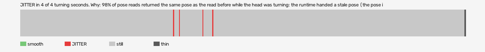

# psychonauts-vr (openxr, VR, headset or simulator not recorded)

Log `psychonauts-vr_20261029-170008.jl`, checked 2026-10-29 17:08. `[measured]`: one VR session.

JITTER in 4 of 4 turning seconds. Why: 98% of pose reads returned the same pose as the read before while the head was turning: the runtime handed a stale pose (the pose is read at the wrong moment, or from a cached copy, not once per frame after waiting for the frame).

- quality: **good**
- 453.16 s; 60.8 pictures, 60.8 pose reads, 57.9 camera writes a second
- turning 4 s, jitter 4 s

## Why

- 98% of pose reads returned the same pose as the read before while the head was turning: the runtime handed a stale pose (the pose is read at the wrong moment, or from a cached copy, not once per frame after waiting for the frame)

## Controllers (Occlusion Drift BeG0nE)

- left: 60.8 reads a second; untracked 0.0% of the time, longest 0.0 s; 0% of the untracked reads came while the other controller was within 0.3 m
- right: 60.8 reads a second; untracked 0.0% of the time, longest 0.0 s; 0% of the untracked reads came while the other controller was within 0.3 m

## On the recording

- a recording is still running: once it stops, run `begone.py frames camera-jitter <run> attach`.
