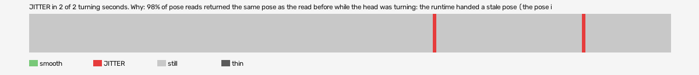

# psychonauts-vr (openxr, VR, headset or simulator not recorded)

Log `psychonauts-vr_20261029-170750.jl`, checked 2026-10-29 17:11. `[measured]`: one VR session.

JITTER in 2 of 2 turning seconds. Why: 98% of pose reads returned the same pose as the read before while the head was turning: the runtime handed a stale pose (the pose is read at the wrong moment, or from a cached copy, not once per frame after waiting for the frame).

- quality: **good**
- 180.8 s; 60.6 pictures, 60.6 pose reads, 56.0 camera writes a second
- turning 2 s, jitter 2 s

## Why

- 98% of pose reads returned the same pose as the read before while the head was turning: the runtime handed a stale pose (the pose is read at the wrong moment, or from a cached copy, not once per frame after waiting for the frame)

## Controllers (Occlusion Drift BeG0nE)

- left: 60.6 reads a second; untracked 0.0% of the time, longest 0.0 s; 100% of the untracked reads came while the other controller was within 0.3 m
- right: 60.6 reads a second; untracked 0.0% of the time, longest 0.0 s; 100% of the untracked reads came while the other controller was within 0.3 m

## On the recording

- **game window**: `begone_2026-10-29_16-52-40.mp4`; the log starts 909.83 s into it (log file made).
  - jitter 114-115s: 90 frames; on screen 1 pictures held, 1 jumped, in `<recordings>/psychonauts-vr/begone-frames/2026-10-29_17-10-51_openxr/jitter_114-115s_game/` (sheet.jpg)
  - jitter 156-157s: 90 frames; on screen 6 pictures held, 3 jumped, in `<recordings>/psychonauts-vr/begone-frames/2026-10-29_17-10-51_openxr/jitter_156-157s_game/` (sheet.jpg)
