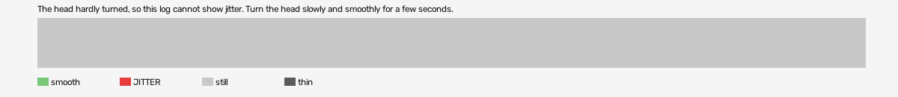

# psychonauts-vr (openxr, VR, headset or simulator not recorded)

Log `psychonauts-vr_20261029-171938.jl`, checked 2026-10-29 17:20. `[measured]`: one VR session.

The head hardly turned, so this log cannot show jitter. Turn the head slowly and smoothly for a few seconds.

- quality: **no-movement**
- 52.68 s; 60.7 pictures, 60.7 pose reads, 51.1 camera writes a second
- turning 0 s, jitter 0 s

## Controllers (Occlusion Drift BeG0nE)

- left: 60.7 reads a second; untracked 0.0% of the time, longest 0.0 s; 0% of the untracked reads came while the other controller was within 0.3 m
- right: 60.7 reads a second; untracked 0.0% of the time, longest 0.0 s; 0% of the untracked reads came while the other controller was within 0.3 m

## On the recording

- a recording is still running: once it stops, run `begone.py frames camera-jitter <run> attach`.
