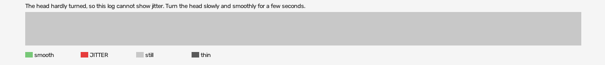

# psychonauts-vr (openxr, VR, headset or simulator not recorded)

Log `psychonauts-vr_20261029-172037.jl`, checked 2026-10-29 17:22. `[measured]`: one VR session.

The head hardly turned, so this log cannot show jitter. Turn the head slowly and smoothly for a few seconds.

- quality: **no-movement**
- 63.83 s; 60.9 pictures, 60.9 pose reads, 51.7 camera writes a second
- turning 0 s, jitter 0 s

## Controllers (Occlusion Drift BeG0nE)

- left: 60.9 reads a second; untracked 0.0% of the time, longest 0.0 s; 0% of the untracked reads came while the other controller was within 0.3 m
- right: 60.9 reads a second; untracked 0.0% of the time, longest 0.0 s; 0% of the untracked reads came while the other controller was within 0.3 m

## On the recording

- **OpenXR Simulator preview**: `begone_second_2026-10-29_17-20-50.mp4`; the log starts -13.20 s into it (log file made).
- **game window**: `begone_2026-10-29_17-20-50.mp4`; the log starts -13.20 s into it (log file made).
- ⚠️ the recording broke at 13 s of the log: OBS showed "OBS has crashed!" (restarted).
