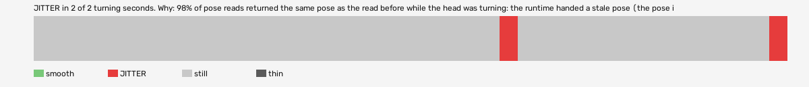

# the-darkness-vr (openxr-sim, headset simulator)

Log `the-darkness-vr_20261128-173407.jl`, checked 2026-11-28 17:35. `[measured]`: one VR session.

JITTER in 2 of 2 turning seconds. Why: 98% of pose reads returned the same pose as the read before while the head was turning: the runtime handed a stale pose (the pose is read at the wrong moment, or from a cached copy, not once per frame after waiting for the frame).

- quality: **good**
- 41.33 s; 89.9 pictures, 89.9 pose reads, 89.9 camera writes a second
- turning 2 s, jitter 2 s

## Why

- 98% of pose reads returned the same pose as the read before while the head was turning: the runtime handed a stale pose (the pose is read at the wrong moment, or from a cached copy, not once per frame after waiting for the frame)

## Controllers (Occlusion Drift BeG0nE)

- left: 89.9 reads a second; untracked 0.0% of the time, longest 0.0 s; 0% of the untracked reads came while the other controller was within 0.3 m
- right: 89.9 reads a second; untracked 0.0% of the time, longest 0.0 s; 0% of the untracked reads came while the other controller was within 0.3 m

## On the recording

- **OpenXR Simulator preview**: `begone_second_2026-11-28_17-34-15.mp4`; the log starts -7.75 s into it (log clock).
  - jitter 26-27s: 90 frames; on screen 0 pictures held, 0 jumped, in `<recordings>/the-darkness-vr/begone-frames/2026-11-28_17-34-49_openxr-sim/jitter_26-27s_headset/` (sheet.jpg)
  - jitter 41-42s: 90 frames; on screen 0 pictures held, 0 jumped, in `<recordings>/the-darkness-vr/begone-frames/2026-11-28_17-34-49_openxr-sim/jitter_41-42s_headset/` (sheet.jpg)
- **game window**: `begone_2026-11-28_17-34-15.mp4`; the log starts -7.75 s into it (log clock).
  - jitter 26-27s: 90 frames; on screen 0 pictures held, 0 jumped, in `<recordings>/the-darkness-vr/begone-frames/2026-11-28_17-34-49_openxr-sim/jitter_26-27s_game/` (sheet.jpg)
  - jitter 41-42s: 90 frames; on screen 0 pictures held, 0 jumped, in `<recordings>/the-darkness-vr/begone-frames/2026-11-28_17-34-49_openxr-sim/jitter_41-42s_game/` (sheet.jpg)
