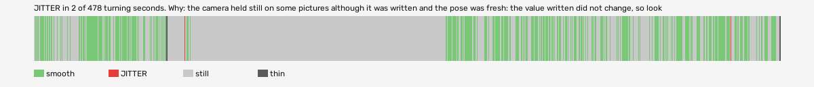

# the-darkness-vr (openxr-headset, real headset)

Log `the-darkness-vr_20261128-174157.jl`, checked 2026-11-28 18:06. `[measured]`: one VR session.

JITTER in 2 of 478 turning seconds. Why: the camera held still on some pictures although it was written and the pose was fresh: the value written did not change, so look at what sits between the pose and the camera (a smoothing step, a rounding, a once-per-tick game update).

- quality: **good**
- 1400.17 s; 61.0 pictures, 59.2 pose reads, 59.2 camera writes a second
- turning 478 s, jitter 2 s

## Why

- the camera held still on some pictures although it was written and the pose was fresh: the value written did not change, so look at what sits between the pose and the camera (a smoothing step, a rounding, a once-per-tick game update)

## Controllers (Occlusion Drift BeG0nE)

- left: 59.2 reads a second; untracked 61.1% of the time, longest 499.16 s; 97% of the untracked reads came while the other controller was within 0.3 m
- right: 59.2 reads a second; untracked 60.1% of the time, longest 499.16 s; 99% of the untracked reads came while the other controller was within 0.3 m

## On the recording

- **OpenXR headset view (OBS Mirror)**: `begone_second_2026-11-28_17-42-07.mp4`; the log starts -8.98 s into it (log clock).
  - jitter 283-284s: 90 frames; on screen 11 pictures held, 13 jumped, in `<recordings>/the-darkness-vr/begone-frames/2026-11-28_18-05-17_openxr-headset/jitter_283-284s_headset/` (sheet.jpg)
  - jitter 1308-1309s: 90 frames; on screen 26 pictures held, 9 jumped, in `<recordings>/the-darkness-vr/begone-frames/2026-11-28_18-05-17_openxr-headset/jitter_1308-1309s_headset/` (sheet.jpg)
  - smooth 12-13s: 90 frames; on screen 18 pictures held, 7 jumped, in `<recordings>/the-darkness-vr/begone-frames/2026-11-28_18-05-17_openxr-headset/smooth_12-13s_headset/` (sheet.jpg)
- **game window**: `begone_2026-11-28_17-42-06.mp4`; the log starts -8.98 s into it (log clock).
  - jitter 283-284s: 90 frames; on screen 2 pictures held, 3 jumped, in `<recordings>/the-darkness-vr/begone-frames/2026-11-28_18-05-17_openxr-headset/jitter_283-284s_game/` (sheet.jpg)
  - jitter 1308-1309s: 90 frames; on screen 25 pictures held, 19 jumped, in `<recordings>/the-darkness-vr/begone-frames/2026-11-28_18-05-17_openxr-headset/jitter_1308-1309s_game/` (sheet.jpg)
  - smooth 12-13s: 90 frames; on screen 15 pictures held, 2 jumped, in `<recordings>/the-darkness-vr/begone-frames/2026-11-28_18-05-17_openxr-headset/smooth_12-13s_game/` (sheet.jpg)
