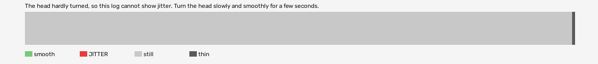

# the-darkness-vr (openxr-sim, headset simulator)

Log `the-darkness-vr_20261128-180911.jl`, checked 2026-11-28 18:13. `[measured]`: one VR session.

The head hardly turned, so this log cannot show jitter. Turn the head slowly and smoothly for a few seconds.

- quality: **no-movement**
- 211.32 s; 46.4 pictures, 46.4 pose reads, 46.4 camera writes a second
- turning 0 s, jitter 0 s

## Controllers (Occlusion Drift BeG0nE)

- left: 46.4 reads a second; untracked 0.0% of the time, longest 0.0 s; 0% of the untracked reads came while the other controller was within 0.3 m
- right: 46.4 reads a second; untracked 0.0% of the time, longest 0.0 s; 0% of the untracked reads came while the other controller was within 0.3 m

## On the recording

- **OpenXR Simulator preview**: `begone_second_2026-11-28_18-09-22.mp4`; the log starts -10.63 s into it (log clock).
- **game window**: `begone_2026-11-28_18-09-22.mp4`; the log starts -10.63 s into it (log clock).
