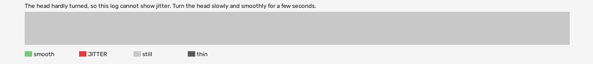

# the-darkness-vr (openxr-sim, headset simulator)

Log `the-darkness-vr_20261128-191642.jl`, checked 2026-11-28 19:18. `[measured]`: one VR session.

The head hardly turned, so this log cannot show jitter. Turn the head slowly and smoothly for a few seconds.

- quality: **no-movement**
- 91.83 s; 62.2 pictures, 62.2 pose reads, 62.2 camera writes a second
- turning 0 s, jitter 0 s

## Controllers (Occlusion Drift BeG0nE)

- left: 62.2 reads a second; untracked 0.0% of the time, longest 0.0 s; 0% of the untracked reads came while the other controller was within 0.3 m
- right: 62.2 reads a second; untracked 0.0% of the time, longest 0.0 s; 0% of the untracked reads came while the other controller was within 0.3 m

## On the recording

- **OpenXR Simulator preview**: `begone_second_2026-11-28_19-16-50.mp4`; the log starts -8.85 s into it (log clock).
- **game window**: `begone_2026-11-28_19-16-50.mp4`; the log starts -8.85 s into it (log clock).
