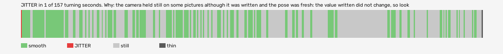

# the-darkness-vr (openxr-headset, real headset)

Log `the-darkness-vr_20261128-192705.jl`, checked 2026-11-28 19:34. `[measured]`: one VR session.

JITTER in 1 of 157 turning seconds. Why: the camera held still on some pictures although it was written and the pose was fresh: the value written did not change, so look at what sits between the pose and the camera (a smoothing step, a rounding, a once-per-tick game update).

- quality: **good**
- 387.34 s; 64.6 pictures, 64.6 pose reads, 64.6 camera writes a second
- turning 157 s, jitter 1 s

## Why

- the camera held still on some pictures although it was written and the pose was fresh: the value written did not change, so look at what sits between the pose and the camera (a smoothing step, a rounding, a once-per-tick game update)

## Controllers (Occlusion Drift BeG0nE)

- left: 64.6 reads a second; untracked 70.7% of the time, longest 161.4 s; 90% of the untracked reads came while the other controller was within 0.3 m
- right: 64.6 reads a second; untracked 65.0% of the time, longest 113.76 s; 98% of the untracked reads came while the other controller was within 0.3 m

## On the recording

- **OpenXR headset view (OBS Mirror)**: `begone_second_2026-11-28_19-27-16.mp4`; the log starts -10.48 s into it (log clock).
  - smooth 11-12s: 90 frames; on screen 23 pictures held, 13 jumped, in `<recordings>/the-darkness-vr/begone-frames/2026-11-28_19-33-32_openxr-headset/smooth_11-12s_headset/` (sheet.jpg)
- **game window**: `begone_2026-11-28_19-27-15.mp4`; the log starts -10.48 s into it (log clock).
  - smooth 11-12s: 90 frames; on screen 20 pictures held, 19 jumped, in `<recordings>/the-darkness-vr/begone-frames/2026-11-28_19-33-32_openxr-headset/smooth_11-12s_game/` (sheet.jpg)
