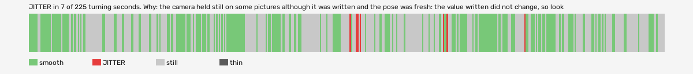

# the-darkness-vr (openxr-headset, real headset)

Log `the-darkness-vr_20261128-194205.jl`, checked 2026-11-28 19:51. `[measured]`: one VR session.

JITTER in 7 of 225 turning seconds. Why: the camera held still on some pictures although it was written and the pose was fresh: the value written did not change, so look at what sits between the pose and the camera (a smoothing step, a rounding, a once-per-tick game update).

- quality: **good**
- 490.85 s; 56.7 pictures, 55.4 pose reads, 55.4 camera writes a second
- turning 225 s, jitter 7 s

## Why

- the camera held still on some pictures although it was written and the pose was fresh: the value written did not change, so look at what sits between the pose and the camera (a smoothing step, a rounding, a once-per-tick game update)

## Controllers (Occlusion Drift BeG0nE)

- left: 55.4 reads a second; untracked 62.7% of the time, longest 124.49 s; 90% of the untracked reads came while the other controller was within 0.3 m
- right: 55.4 reads a second; untracked 61.1% of the time, longest 82.85 s; 90% of the untracked reads came while the other controller was within 0.3 m

## On the recording

- **OpenXR headset view (OBS Mirror)**: `begone_second_2026-11-28_19-42-26.mp4`; the log starts -21.57 s into it (log clock).
  - jitter 248-249s: 90 frames; on screen 12 pictures held, 11 jumped, in `<recordings>/the-darkness-vr/begone-frames/2026-11-28_19-50-15_openxr-headset/jitter_248-249s_headset/` (sheet.jpg)
  - jitter 253-255s: 150 frames; on screen 31 pictures held, 29 jumped, in `<recordings>/the-darkness-vr/begone-frames/2026-11-28_19-50-15_openxr-headset/jitter_253-255s_headset/` (sheet.jpg)
  - jitter 256-257s: 90 frames; on screen 26 pictures held, 12 jumped, in `<recordings>/the-darkness-vr/begone-frames/2026-11-28_19-50-15_openxr-headset/jitter_256-257s_headset/` (sheet.jpg)
  - smooth 22-23s: 90 frames; on screen 25 pictures held, 18 jumped, in `<recordings>/the-darkness-vr/begone-frames/2026-11-28_19-50-15_openxr-headset/smooth_22-23s_headset/` (sheet.jpg)
- **game window**: `begone_2026-11-28_19-42-26.mp4`; the log starts -21.57 s into it (log clock).
  - jitter 248-249s: 90 frames; on screen 13 pictures held, 14 jumped, in `<recordings>/the-darkness-vr/begone-frames/2026-11-28_19-50-15_openxr-headset/jitter_248-249s_game/` (sheet.jpg)
  - jitter 253-255s: 150 frames; on screen 16 pictures held, 10 jumped, in `<recordings>/the-darkness-vr/begone-frames/2026-11-28_19-50-15_openxr-headset/jitter_253-255s_game/` (sheet.jpg)
  - jitter 256-257s: 90 frames; on screen 23 pictures held, 10 jumped, in `<recordings>/the-darkness-vr/begone-frames/2026-11-28_19-50-15_openxr-headset/jitter_256-257s_game/` (sheet.jpg)
  - smooth 22-23s: 90 frames; on screen 29 pictures held, 18 jumped, in `<recordings>/the-darkness-vr/begone-frames/2026-11-28_19-50-15_openxr-headset/smooth_22-23s_game/` (sheet.jpg)
- ⚠️ the recording broke at 22 s of the log: OBS showed "OBS has crashed!" (restarted).
