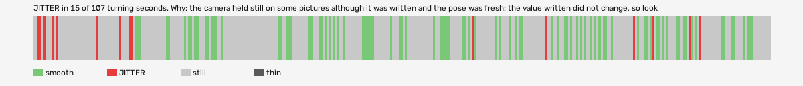

# visceral-re8-vr (openxr, VR, headset or simulator not recorded)

Log `visceral-re8-vr_20261126-195754.jl`, checked 2026-11-26 20:04. `[measured]`: one VR session.

JITTER in 15 of 107 turning seconds. Why: the camera held still on some pictures although it was written and the pose was fresh: the value written did not change, so look at what sits between the pose and the camera (a smoothing step, a rounding, a once-per-tick game update).

- quality: **good**
- 360.61 s; 71.7 pictures, 71.7 pose reads, 71.7 camera writes a second
- turning 107 s, jitter 15 s

## Why

- the camera held still on some pictures although it was written and the pose was fresh: the value written did not change, so look at what sits between the pose and the camera (a smoothing step, a rounding, a once-per-tick game update)

## Controllers (Occlusion Drift BeG0nE)

- left: 71.7 reads a second; untracked 27.0% of the time, longest 22.78 s; 93% of the untracked reads came while the other controller was within 0.3 m
- right: 71.7 reads a second; untracked 56.3% of the time, longest 200.61 s; 45% of the untracked reads came while the other controller was within 0.3 m

## Marks the mod left

- 0.0 s: rebuild2 off=[] scriptbody_off=0

## On the recording

- **OpenXR headset view (OBS Mirror)**: `begone_second_2026-11-26_19-58-01.mp4`; the log starts -7.22 s into it (log clock).
  - jitter 9-10s: 90 frames; on screen 1 pictures held, 3 jumped, in `<recordings>/visceral-re8-vr/begone-frames/2026-11-26_20-03-55_openxr/jitter_9-10s_headset/` (sheet.jpg)
  - jitter 11-12s: 90 frames; on screen 1 pictures held, 4 jumped, in `<recordings>/visceral-re8-vr/begone-frames/2026-11-26_20-03-55_openxr/jitter_11-12s_headset/` (sheet.jpg)
  - jitter 31-32s: 90 frames; on screen 1 pictures held, 4 jumped, in `<recordings>/visceral-re8-vr/begone-frames/2026-11-26_20-03-55_openxr/jitter_31-32s_headset/` (sheet.jpg)
  - smooth 50-51s: 90 frames; on screen 1 pictures held, 2 jumped, in `<recordings>/visceral-re8-vr/begone-frames/2026-11-26_20-03-55_openxr/smooth_50-51s_headset/` (sheet.jpg)
- **game window**: `begone_2026-11-26_19-58-01.mp4`; the log starts -7.22 s into it (log clock).
  - jitter 9-10s: 90 frames; on screen 7 pictures held, 3 jumped, in `<recordings>/visceral-re8-vr/begone-frames/2026-11-26_20-03-55_openxr/jitter_9-10s_game/` (sheet.jpg)
  - jitter 11-12s: 90 frames; on screen 8 pictures held, 5 jumped, in `<recordings>/visceral-re8-vr/begone-frames/2026-11-26_20-03-55_openxr/jitter_11-12s_game/` (sheet.jpg)
  - jitter 31-32s: 90 frames; on screen 7 pictures held, 1 jumped, in `<recordings>/visceral-re8-vr/begone-frames/2026-11-26_20-03-55_openxr/jitter_31-32s_game/` (sheet.jpg)
  - smooth 50-51s: 90 frames; on screen 10 pictures held, 7 jumped, in `<recordings>/visceral-re8-vr/begone-frames/2026-11-26_20-03-55_openxr/smooth_50-51s_game/` (sheet.jpg)
