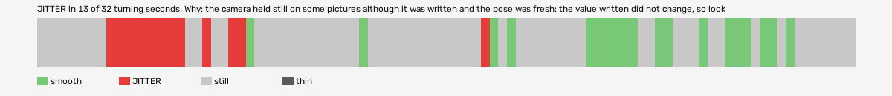

# visceral-re8-vr (openxr, VR, headset or simulator not recorded)

Log `visceral-re8-vr_20261126-200545.jl`, checked 2026-11-26 20:07. `[measured]`: one VR session.

JITTER in 13 of 32 turning seconds. Why: the camera held still on some pictures although it was written and the pose was fresh: the value written did not change, so look at what sits between the pose and the camera (a smoothing step, a rounding, a once-per-tick game update).

- quality: **good**
- 93.89 s; 71.0 pictures, 71.0 pose reads, 71.0 camera writes a second
- turning 32 s, jitter 13 s

## Why

- the camera held still on some pictures although it was written and the pose was fresh: the value written did not change, so look at what sits between the pose and the camera (a smoothing step, a rounding, a once-per-tick game update)

## Controllers (Occlusion Drift BeG0nE)

- left: 71.0 reads a second; untracked 11.8% of the time, longest 11.01 s; 100% of the untracked reads came while the other controller was within 0.3 m
- right: 71.0 reads a second; untracked 13.5% of the time, longest 12.64 s; 100% of the untracked reads came while the other controller was within 0.3 m

## Marks the mod left

- 0.0 s: rebuild2 off=[frame scriptbody] scriptbody_off=1

## On the recording

- **OpenXR headset view (OBS Mirror)**: `begone_second_2026-11-26_20-05-51.mp4`; the log starts -6.72 s into it (log clock).
  - jitter 8-17s: 150 frames; on screen 0 pictures held, 1 jumped, in `<recordings>/visceral-re8-vr/begone-frames/2026-11-26_20-07-19_openxr/jitter_8-17s_headset/` (sheet.jpg)
  - jitter 19-20s: 90 frames; on screen 0 pictures held, 1 jumped, in `<recordings>/visceral-re8-vr/begone-frames/2026-11-26_20-07-19_openxr/jitter_19-20s_headset/` (sheet.jpg)
  - jitter 22-24s: 150 frames; on screen 1 pictures held, 4 jumped, in `<recordings>/visceral-re8-vr/begone-frames/2026-11-26_20-07-19_openxr/jitter_22-24s_headset/` (sheet.jpg)
  - smooth 24-25s: 90 frames; on screen 0 pictures held, 0 jumped, in `<recordings>/visceral-re8-vr/begone-frames/2026-11-26_20-07-19_openxr/smooth_24-25s_headset/` (sheet.jpg)
- **game window**: `begone_2026-11-26_20-05-51.mp4`; the log starts -6.72 s into it (log clock).
  - jitter 8-17s: 150 frames; on screen 6 pictures held, 5 jumped, in `<recordings>/visceral-re8-vr/begone-frames/2026-11-26_20-07-19_openxr/jitter_8-17s_game/` (sheet.jpg)
  - jitter 19-20s: 90 frames; on screen 3 pictures held, 2 jumped, in `<recordings>/visceral-re8-vr/begone-frames/2026-11-26_20-07-19_openxr/jitter_19-20s_game/` (sheet.jpg)
  - jitter 22-24s: 150 frames; on screen 9 pictures held, 4 jumped, in `<recordings>/visceral-re8-vr/begone-frames/2026-11-26_20-07-19_openxr/jitter_22-24s_game/` (sheet.jpg)
  - smooth 24-25s: 90 frames; on screen 14 pictures held, 3 jumped, in `<recordings>/visceral-re8-vr/begone-frames/2026-11-26_20-07-19_openxr/smooth_24-25s_game/` (sheet.jpg)
