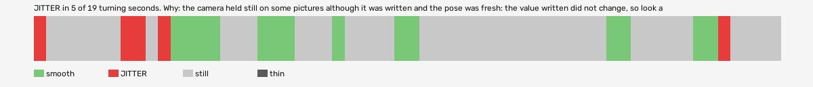

# visceral-re8-vr (openxr, VR, headset or simulator not recorded)

Log `visceral-re8-vr_20261126-202942.jl`, checked 2026-11-26 20:31. `[measured]`: one VR session.

JITTER in 5 of 19 turning seconds. Why: the camera held still on some pictures although it was written and the pose was fresh: the value written did not change, so look at what sits between the pose and the camera (a smoothing step, a rounding, a once-per-tick game update).

- quality: **good**
- 59.88 s; 71.0 pictures, 71.0 pose reads, 71.0 camera writes a second
- turning 19 s, jitter 5 s

## Why

- the camera held still on some pictures although it was written and the pose was fresh: the value written did not change, so look at what sits between the pose and the camera (a smoothing step, a rounding, a once-per-tick game update)

## Controllers (Occlusion Drift BeG0nE)

- left: 71.0 reads a second; untracked 0.0% of the time, longest 0.0 s; 0% of the untracked reads came while the other controller was within 0.3 m
- right: 71.0 reads a second; untracked 0.0% of the time, longest 0.0 s; 0% of the untracked reads came while the other controller was within 0.3 m

## Marks the mod left

- 0.0 s: rebuild2 off=[gamearms doors bodyturn spinestill fingers carryarms sleephands leanfix leanrec scriptbody] scriptbody_off=1

## On the recording

- **OpenXR headset view (OBS Mirror)**: `begone_second_2026-11-26_20-29-53.mp4`; the log starts -11.26 s into it (log clock).
  - jitter 55-56s: 90 frames; on screen 1 pictures held, 0 jumped, in `<recordings>/visceral-re8-vr/begone-frames/2026-11-26_20-30-42_openxr/jitter_55-56s_headset/` (sheet.jpg)
  - smooth 12-13s: 90 frames; on screen 0 pictures held, 0 jumped, in `<recordings>/visceral-re8-vr/begone-frames/2026-11-26_20-30-42_openxr/smooth_12-13s_headset/` (sheet.jpg)
- **game window**: `begone_2026-11-26_20-29-53.mp4`; the log starts -11.26 s into it (log clock).
  - jitter 55-56s: 90 frames; on screen 2 pictures held, 1 jumped, in `<recordings>/visceral-re8-vr/begone-frames/2026-11-26_20-30-42_openxr/jitter_55-56s_game/` (sheet.jpg)
  - smooth 12-13s: 90 frames; on screen 1 pictures held, 1 jumped, in `<recordings>/visceral-re8-vr/begone-frames/2026-11-26_20-30-42_openxr/smooth_12-13s_game/` (sheet.jpg)
