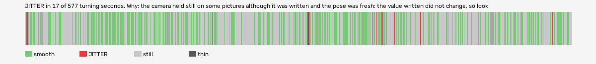

# visceral-re8-vr (openxr, VR, headset or simulator not recorded)

Log `visceral-re8-vr_20261126-212040.jl`, checked 2026-11-26 21:44. `[measured]`: one VR session.

JITTER in 17 of 577 turning seconds. Why: the camera held still on some pictures although it was written and the pose was fresh: the value written did not change, so look at what sits between the pose and the camera (a smoothing step, a rounding, a once-per-tick game update).

- quality: **good**
- 1342.28 s; 71.4 pictures, 71.4 pose reads, 71.4 camera writes a second
- turning 577 s, jitter 17 s

## Why

- the camera held still on some pictures although it was written and the pose was fresh: the value written did not change, so look at what sits between the pose and the camera (a smoothing step, a rounding, a once-per-tick game update)

## Controllers (Occlusion Drift BeG0nE)

- left: 71.4 reads a second; untracked 45.3% of the time, longest 265.13 s; 100% of the untracked reads came while the other controller was within 0.3 m
- right: 71.4 reads a second; untracked 53.2% of the time, longest 411.2 s; 85% of the untracked reads came while the other controller was within 0.3 m

## Marks the mod left

- 0.0 s: rebuild2 off=[] scriptbody_off=0

## On the recording

- **OpenXR headset view (OBS Mirror)**: `begone_second_2026-11-26_21-20-47.mp4`; the log starts -6.88 s into it (log clock).
  - jitter 7-8s: 90 frames; on screen 1 pictures held, 3 jumped, in `<recordings>/visceral-re8-vr/begone-frames/2026-11-26_21-43-02_openxr/jitter_7-8s_headset/` (sheet.jpg)
  - jitter 461-462s: 90 frames; on screen 1 pictures held, 2 jumped, in `<recordings>/visceral-re8-vr/begone-frames/2026-11-26_21-43-02_openxr/jitter_461-462s_headset/` (sheet.jpg)
  - jitter 614-615s: 90 frames; on screen 1 pictures held, 3 jumped, in `<recordings>/visceral-re8-vr/begone-frames/2026-11-26_21-43-02_openxr/jitter_614-615s_headset/` (sheet.jpg)
  - smooth 9-10s: 90 frames; on screen 0 pictures held, 3 jumped, in `<recordings>/visceral-re8-vr/begone-frames/2026-11-26_21-43-02_openxr/smooth_9-10s_headset/` (sheet.jpg)
- **game window**: `begone_2026-11-26_21-20-47.mp4`; the log starts -6.88 s into it (log clock).
  - jitter 7-8s: 90 frames; on screen 0 pictures held, 0 jumped, in `<recordings>/visceral-re8-vr/begone-frames/2026-11-26_21-43-02_openxr/jitter_7-8s_game/` (sheet.jpg)
  - jitter 461-462s: 90 frames; on screen 7 pictures held, 1 jumped, in `<recordings>/visceral-re8-vr/begone-frames/2026-11-26_21-43-02_openxr/jitter_461-462s_game/` (sheet.jpg)
  - jitter 614-615s: 90 frames; on screen 8 pictures held, 7 jumped, in `<recordings>/visceral-re8-vr/begone-frames/2026-11-26_21-43-02_openxr/jitter_614-615s_game/` (sheet.jpg)
  - smooth 9-10s: 90 frames; on screen 3 pictures held, 3 jumped, in `<recordings>/visceral-re8-vr/begone-frames/2026-11-26_21-43-02_openxr/smooth_9-10s_game/` (sheet.jpg)
