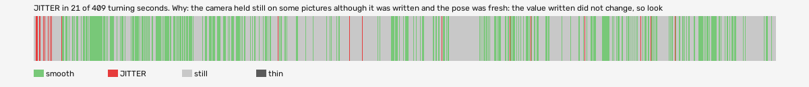

# visceral-re8-vr (openxr, VR, headset or simulator not recorded)

Log `visceral-re8-vr_20261126-214433.jl`, checked 2026-11-26 22:04. `[measured]`: one VR session.

JITTER in 21 of 409 turning seconds. Why: the camera held still on some pictures although it was written and the pose was fresh: the value written did not change, so look at what sits between the pose and the camera (a smoothing step, a rounding, a once-per-tick game update).

- quality: **good**
- 1133.28 s; 70.4 pictures, 70.4 pose reads, 70.4 camera writes a second
- turning 409 s, jitter 21 s

## Why

- the camera held still on some pictures although it was written and the pose was fresh: the value written did not change, so look at what sits between the pose and the camera (a smoothing step, a rounding, a once-per-tick game update)

## Controllers (Occlusion Drift BeG0nE)

- left: 70.4 reads a second; untracked 53.7% of the time, longest 346.16 s; 98% of the untracked reads came while the other controller was within 0.3 m
- right: 70.4 reads a second; untracked 64.3% of the time, longest 346.16 s; 82% of the untracked reads came while the other controller was within 0.3 m

## Marks the mod left

- 0.0 s: rebuild2 off=[] scriptbody_off=0

## On the recording

- **OpenXR headset view (OBS Mirror)**: `begone_second_2026-11-26_21-44-40.mp4`; the log starts -7.09 s into it (log clock).
  - jitter 9-11s: 150 frames; on screen 1 pictures held, 16 jumped, in `<recordings>/visceral-re8-vr/begone-frames/2026-11-26_22-03-26_openxr/jitter_9-11s_headset/` (sheet.jpg)
  - jitter 15-16s: 90 frames; on screen 2 pictures held, 9 jumped, in `<recordings>/visceral-re8-vr/begone-frames/2026-11-26_22-03-26_openxr/jitter_15-16s_headset/` (sheet.jpg)
  - jitter 17-18s: 90 frames; on screen 1 pictures held, 11 jumped, in `<recordings>/visceral-re8-vr/begone-frames/2026-11-26_22-03-26_openxr/jitter_17-18s_headset/` (sheet.jpg)
  - smooth 44-45s: 90 frames; on screen 1 pictures held, 2 jumped, in `<recordings>/visceral-re8-vr/begone-frames/2026-11-26_22-03-26_openxr/smooth_44-45s_headset/` (sheet.jpg)
- **game window**: `begone_2026-11-26_21-44-40.mp4`; the log starts -7.09 s into it (log clock).
  - jitter 9-11s: 150 frames; on screen 8 pictures held, 12 jumped, in `<recordings>/visceral-re8-vr/begone-frames/2026-11-26_22-03-26_openxr/jitter_9-11s_game/` (sheet.jpg)
  - jitter 15-16s: 90 frames; on screen 4 pictures held, 6 jumped, in `<recordings>/visceral-re8-vr/begone-frames/2026-11-26_22-03-26_openxr/jitter_15-16s_game/` (sheet.jpg)
  - jitter 17-18s: 90 frames; on screen 6 pictures held, 8 jumped, in `<recordings>/visceral-re8-vr/begone-frames/2026-11-26_22-03-26_openxr/jitter_17-18s_game/` (sheet.jpg)
  - smooth 44-45s: 90 frames; on screen 10 pictures held, 4 jumped, in `<recordings>/visceral-re8-vr/begone-frames/2026-11-26_22-03-26_openxr/smooth_44-45s_game/` (sheet.jpg)
