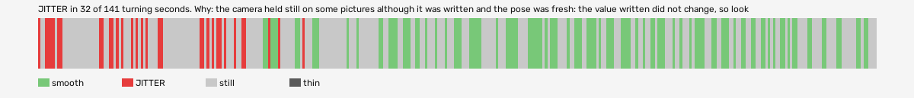

# visceral-re8-vr (openxr, VR, headset or simulator not recorded)

Log `visceral-re8-vr_20261126-220438.jl`, checked 2026-11-26 22:10. `[measured]`: one VR session.

JITTER in 32 of 141 turning seconds. Why: the camera held still on some pictures although it was written and the pose was fresh: the value written did not change, so look at what sits between the pose and the camera (a smoothing step, a rounding, a once-per-tick game update).

- quality: **good**
- 341.92 s; 71.2 pictures, 71.2 pose reads, 71.2 camera writes a second
- turning 141 s, jitter 32 s

## Why

- the camera held still on some pictures although it was written and the pose was fresh: the value written did not change, so look at what sits between the pose and the camera (a smoothing step, a rounding, a once-per-tick game update)

## Controllers (Occlusion Drift BeG0nE)

- left: 71.2 reads a second; untracked 43.7% of the time, longest 83.95 s; 98% of the untracked reads came while the other controller was within 0.3 m
- right: 71.2 reads a second; untracked 46.7% of the time, longest 83.95 s; 92% of the untracked reads came while the other controller was within 0.3 m

## Marks the mod left

- 0.0 s: rebuild2 off=[] scriptbody_off=0

## On the recording

- **OpenXR headset view (OBS Mirror)**: `begone_second_2026-11-26_22-04-47.mp4`; the log starts -9.32 s into it (log clock).
  - jitter 25-27s: 150 frames; on screen 0 pictures held, 4 jumped, in `<recordings>/visceral-re8-vr/begone-frames/2026-11-26_22-10-20_openxr/jitter_25-27s_headset/` (sheet.jpg)
  - jitter 29-31s: 150 frames; on screen 0 pictures held, 0 jumped, in `<recordings>/visceral-re8-vr/begone-frames/2026-11-26_22-10-20_openxr/jitter_29-31s_headset/` (sheet.jpg)
  - jitter 32-33s: 90 frames; on screen 0 pictures held, 1 jumped, in `<recordings>/visceral-re8-vr/begone-frames/2026-11-26_22-10-20_openxr/jitter_32-33s_headset/` (sheet.jpg)
  - smooth 92-93s: 90 frames; on screen 1 pictures held, 3 jumped, in `<recordings>/visceral-re8-vr/begone-frames/2026-11-26_22-10-20_openxr/smooth_92-93s_headset/` (sheet.jpg)
- **game window**: `begone_2026-11-26_22-04-47.mp4`; the log starts -9.32 s into it (log clock).
  - jitter 25-27s: 150 frames; on screen 14 pictures held, 4 jumped, in `<recordings>/visceral-re8-vr/begone-frames/2026-11-26_22-10-20_openxr/jitter_25-27s_game/` (sheet.jpg)
  - jitter 29-31s: 150 frames; on screen 13 pictures held, 4 jumped, in `<recordings>/visceral-re8-vr/begone-frames/2026-11-26_22-10-20_openxr/jitter_29-31s_game/` (sheet.jpg)
  - jitter 32-33s: 90 frames; on screen 5 pictures held, 0 jumped, in `<recordings>/visceral-re8-vr/begone-frames/2026-11-26_22-10-20_openxr/jitter_32-33s_game/` (sheet.jpg)
  - smooth 92-93s: 90 frames; on screen 5 pictures held, 3 jumped, in `<recordings>/visceral-re8-vr/begone-frames/2026-11-26_22-10-20_openxr/smooth_92-93s_game/` (sheet.jpg)
