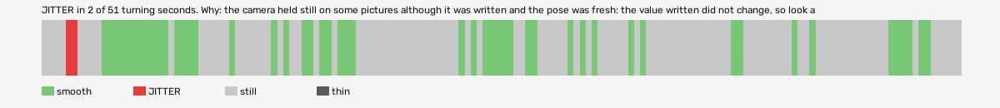

# visceral-re8-vr (openxr, VR, headset or simulator not recorded)

Log `visceral-re8-vr_20261126-231229.jl`, checked 2026-11-26 23:15. `[measured]`: one VR session.

JITTER in 2 of 51 turning seconds. Why: the camera held still on some pictures although it was written and the pose was fresh: the value written did not change, so look at what sits between the pose and the camera (a smoothing step, a rounding, a once-per-tick game update).

- quality: **good**
- 151.52 s; 71.6 pictures, 71.6 pose reads, 71.6 camera writes a second
- turning 51 s, jitter 2 s

## Why

- the camera held still on some pictures although it was written and the pose was fresh: the value written did not change, so look at what sits between the pose and the camera (a smoothing step, a rounding, a once-per-tick game update)

## Controllers (Occlusion Drift BeG0nE)

- left: 71.6 reads a second; untracked 55.4% of the time, longest 51.83 s; 98% of the untracked reads came while the other controller was within 0.3 m
- right: 71.6 reads a second; untracked 63.0% of the time, longest 94.91 s; 86% of the untracked reads came while the other controller was within 0.3 m

## Marks the mod left

- 0.0 s: rebuild2 off=[] scriptbody_off=0

## On the recording

- **OpenXR headset view (OBS Mirror)**: `begone_second_2026-11-26_23-12-37.mp4`; the log starts -7.95 s into it (log clock).
  - smooth 10-11s: 90 frames; on screen 1 pictures held, 1 jumped, in `<recordings>/visceral-re8-vr/begone-frames/2026-11-26_23-15-01_openxr/smooth_10-11s_headset/` (sheet.jpg)
- **game window**: `begone_2026-11-26_23-12-37.mp4`; the log starts -7.95 s into it (log clock).
  - smooth 10-11s: 90 frames; on screen 16 pictures held, 3 jumped, in `<recordings>/visceral-re8-vr/begone-frames/2026-11-26_23-15-01_openxr/smooth_10-11s_game/` (sheet.jpg)
